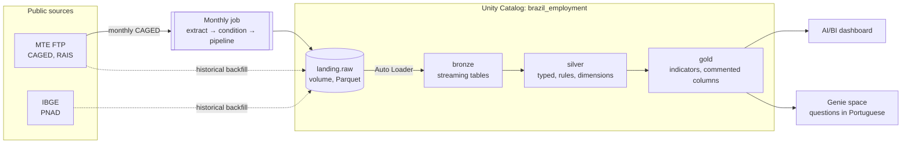

# brazil-employment-lakehouse

[](https://github.com/JoaoEscorcio/brazil-employment-lakehouse/actions/workflows/ci-cd.yml)

End-to-end Databricks lakehouse for Brazilian public employment data (CAGED, RAIS, PNAD) in the
Fortaleza Metropolitan Region (RMF): medallion architecture, Unity Catalog, Lakeflow declarative
pipelines, data quality expectations, AI/BI dashboard, Genie, a monthly job and CI/CD with
Databricks Asset Bundles.

Built as a proof of concept of a **youth labor market observatory** for a municipal secretariat
in Fortaleza, on Databricks Free Edition.

## What it answers

Three official sources, each answering a different question:

| Source | Publisher | What it measures | Granularity used |
|---|---|---|---|
| **Novo CAGED** | Ministry of Labor (MTE) | Monthly **flow** of formal jobs: hires, separations, net balance | Monthly, last 12 months, by municipality |
| **RAIS** | Ministry of Labor (MTE) | **Stock** of formal jobs on Dec 31, including civil servants: wages, firm size, turnover | Yearly (2025), by municipality |
| **PNAD Contínua** | IBGE | Household **survey**: unemployment and informality, which administrative records cannot see | Quarterly, RMF / Fortaleza / rest of the RMF |

Some findings from the current data (Sep/2025 to Aug/2026 for CAGED, Q2/2026 for PNAD, 2025 for RAIS):

- **Young people (15 to 29) took almost all new formal jobs**: +29,192 of the +29,826 net formal jobs in 12 months.
- **Youth unemployment is roughly double** the regional rate (13.6% vs 7.0% in Q2/2026).
- In the 10 sectors that hire the most 18-to-24-year-olds, the **median entry wage stays between R$ 1,621 (one minimum wage) and R$ 1,722**.
- Outside Fortaleza, formal jobs pay much less (RAIS average December wage R$ 2,988 vs R$ 4,296) and **labor income is about half** (PNAD R$ 2,163 vs R$ 4,086).

## Architecture



| Layer | What happens | How |
|---|---|---|
| **Landing** | Files filtered to the 19 RMF municipalities, all columns as text | Unity Catalog volume, Hive-style partitions (`tipo=MOV/competencia=202608`) |
| **Bronze** | Raw data as delivered, plus audit columns (source file, ingestion time) | Lakeflow streaming tables with Auto Loader: incremental and idempotent |
| **Silver** | Types, code translation (conformed dimensions), business rules, plausibility checks | Materialized views with **expectations**; rules in pure Python (`src/regras`) |
| **Gold** | Indicators ready for the dashboard and Genie: additive measures, pre-computed medians (`GROUP BY CUBE`), PNAD weighted components | SQL materialized views, every column with a `COMMENT` |

Every non-obvious rule comes from a finding of the data profiling (`docs/perfilamento.md`, findings A0 to A11).

## Data quality

- **Expectations** in silver and gold (e.g. plausible wage range, valid municipality, minimum sample size for medians and survey estimates).
- **60 unit tests** for the business rules and the Spark column helpers (`tests/`). One test fails on purpose every January until the new minimum wage is registered.
- **Reconciled with the legacy system** (Emprega+, PostgreSQL): CAGED monthly balance, RAIS stock, wages, Gini, turnover and location quotient, and the 14 PNAD indicators matched exactly. The two discrepancies found were bugs in the legacy system (findings A10 and A11).

## Automation and deployment

```
branch ─► pull request ─► CI: unit tests + bundle validate ─► merge to main ─► CD: bundle deploy -t prod
```

- **Monthly job** (`resources/job.yml`): every Monday it looks for new CAGED months on the MTE FTP, loads only what is missing and, only if new data arrived, refreshes the pipeline. Failure alerts by e-mail.
- **Databricks Asset Bundle** (`databricks.yml`, `resources/`): pipeline, job, dashboard and Genie space as code.
- **Two targets**: `dev` (catalog `brazil_employment_dev`, paused schedules, `[dev user]` prefix) and `prod`. The pipeline code has **no catalog name**: tables are `schema.table`, and the catalog comes from the pipeline configuration. Dev reads the same landing as prod and writes only to its own catalog.
- **GitHub Actions** (`.github/workflows/ci-cd.yml`) deploys to prod with a **service principal** (OAuth M2M). The pipeline and the job run as a named user; the dashboard is published with the service principal's credentials. `main` is protected: merges need green tests and validation.

### Deploying to another workspace

1. Create the catalog structure: `src/setup/00_catalogo.sql` (prod) and `src/setup/02_catalogo_dev.sql` (dev).
2. Load the historical data into the landing volume (`ingestao_local/preparar_landing.py`).
3. Point `workspace.host` in `databricks.yml` to the new workspace.
4. Set the variables without defaults (kept out of this public repository):
   ```bash
   export BUNDLE_VAR_email_alerta=alerts@example.org
   export BUNDLE_VAR_usuario_prod=owner@example.org
   ```
5. `databricks bundle deploy -t dev`, run the dev pipeline, check, then `databricks bundle deploy -t prod`.
6. For CI/CD: create a service principal (workspace admin, `USE CATALOG`/`USE SCHEMA`/`SELECT` on the catalog, `CAN USE` on the warehouse) and add the repository secrets `DATABRICKS_CLIENT_ID`, `DATABRICKS_CLIENT_SECRET`, `EMAIL_ALERTA` and `USUARIO_PROD`.

## Repository structure

```
databricks.yml            bundle: variables and dev/prod targets
resources/                pipeline, job, dashboard and Genie space definitions
src/pipelines/            Lakeflow code: bronze.py, silver_*.py, gold_*.sql
src/regras/               business rules in pure Python (RMF, age groups, firm size, informality)
src/comum/                Spark column helpers shared by the silver layer
src/extracao/             monthly CAGED extraction notebook (FTP → landing)
src/exploracao/           data profiling notebooks
src/setup/                catalog creation scripts
dashboards/               AI/BI dashboard definition (.lvdash.json)
genie/                    how the Genie space is built and maintained
tests/                    unit tests (pytest)
ingestao_local/           one-off historical backfill, run locally
docs/                     profiling findings, gold design, maintenance guide
```

## Documentation

- [`docs/perfilamento.md`](docs/perfilamento.md): data profiling findings that drive the silver rules.
- [`docs/perguntas.md`](docs/perguntas.md): gold design, the questions it answers and the indicators reused from the legacy system.
- [`docs/manutencao.md`](docs/manutencao.md): what runs by itself and what needs a person (yearly minimum wage, quarterly PNAD, yearly RAIS).
- [`genie/README.md`](genie/README.md): how the Genie space is configured.

## Limitations

- Public microdata have no worker or firm identifiers: no first-job indicator, no neighborhood breakdown, no tracking of program participants.
- PNAD is a sample survey: estimates are only published for the RMF, Fortaleza and the rest of the RMF, and small cells are flagged as unreliable.
- Built on Databricks Free Edition (serverless only, daily quota, non-commercial use).

## Stack

Databricks (Unity Catalog, Lakeflow declarative pipelines, Auto Loader, Jobs, AI/BI dashboards, Genie, Asset Bundles), PySpark, SQL, Python, pytest, GitHub Actions.
